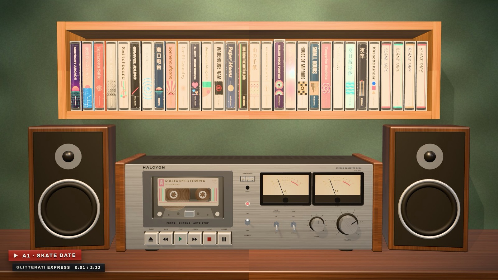
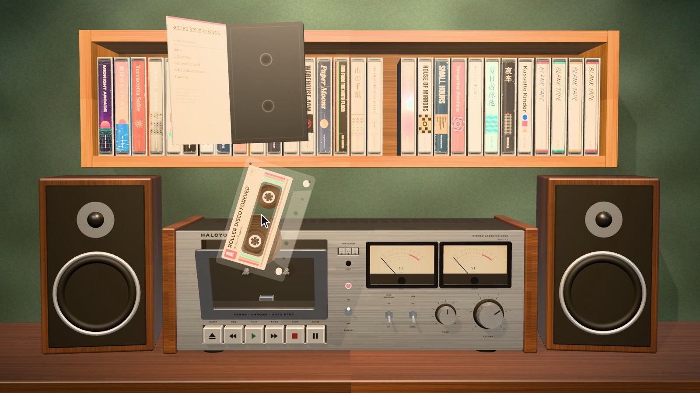
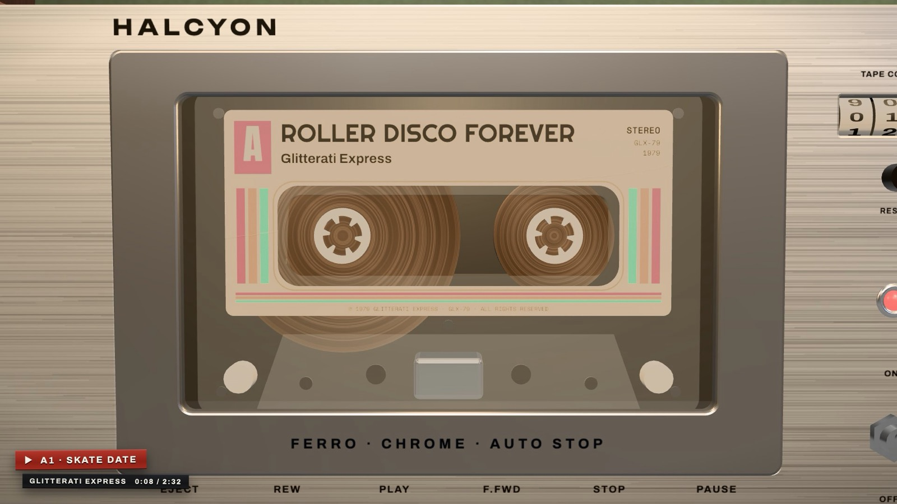
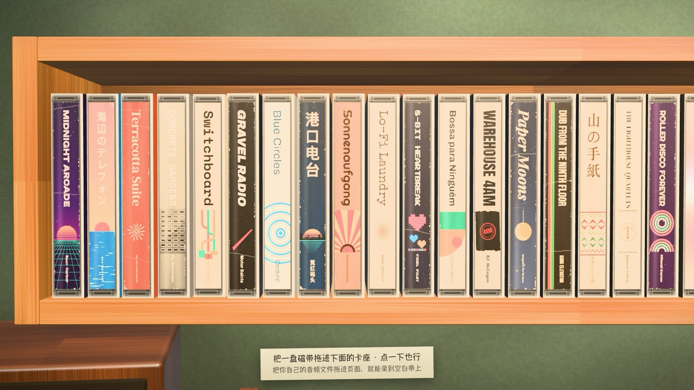

# 磁带柜 · Tape Shelf

一个拟物风的 3D 网页：墙上一排磁带，下面一台 70 年代风格的卡座。把磁带从架子上拖进卡座，盒盖翻开、磁带取出、落进仓门，卷轴转起来，音乐响起。

A skeuomorphic 3D web toy: a shelf of cassettes and a silver-face tape deck. Drag a tape into the deck and it plays. Everything — models, artwork, music, mechanical sounds — is generated in code. No build step, no assets.

**在线体验 / Live demo: <https://tape-shelf.vercel.app>**



| 取带入仓 | 卷轴特写 | 陈列架 |
| --- | --- | --- |
|  |  |  |

## 怎么玩

- **拖一盘磁带到卡座上**，或者直接点一下磁带。卡座里已经有带子时，旧带会先退回自己的盒子。
- **卡座按键**：EJECT、REW、PLAY、F.FWD、STOP、PAUSE，都能点。旋钮可以拖（音量、音调），拨杆可以拨（电源、降噪）。
- **录自己的音乐**：把一个音频文件（mp3、wav、flac…）拖进页面，它会被"录"到一盘空白带上，标签变成手写的文件名。文件只在你的浏览器里解码，不会上传。
- **键盘**：方向键选带，回车装入；空格播放 / 停止；`E` 退带、`R` 倒带、`F` 快进、`S` 停止、`P` 暂停。

浏览器要求先有一次点击或拖拽才允许出声。

## 里面有什么

- **30 盘磁带**：26 张虚构专辑，各有自己的脊标、封面、内页曲目表和磁带贴纸，全部用 Canvas 2D 现画；另有 4 盘空白带。
- **程序化音乐**：每盘带按曲风（合成器浪潮、city pop、爵士、bossa、dub、techno、古典等 20 种）用 Web Audio 离线合成 4 首曲子，同一盘带每次听到的都一样。
- **走带**：两个卷轴按各自带盘的半径以不同转速转动，带盘半径按面积守恒变化；起停时音调会像真磁带一样滑动；带子记得自己放到了哪里。
- **卡座**：VU 表跟随真实电平，机械计数器带进位，仓门、按键、磁带盒的声音都是合成的。
- **自适应布局**：宽屏一排 30 盘加一对音箱，竖屏变成两排。

## 本地运行

没有构建步骤，但页面用了 ES 模块，需要通过本地服务器打开（不能直接双击 `index.html`）：

```bash
python3 -m http.server 5183 --bind 127.0.0.1
```

然后访问 <http://localhost:5183>。macOS 上也可以直接双击 `start.command`。

页面运行时会从 CDN 加载 [three.js](https://threejs.org/)（jsDelivr）和几款字体（Google Fonts），所以需要联网。字体加载不到时会退回系统字体。

`art.html` 是一张贴图总览页，可以一次看到全部脊标；加 `?covers` 还能看封面和磁带贴纸。

## 代码结构

| 文件 | 内容 |
| --- | --- |
| `index.html` | 页面外壳和提示条样式 |
| `src/main.js` | 渲染器、灯光、自适应取景、帧循环 |
| `src/flow.js` | 交互与编排：拖拽、装带 / 退带的动作、走带按键 |
| `src/deck.js` | 卡座模型：面板、仓门、按键、VU 表、计数器、旋钮 |
| `src/cassette.js` | 磁带盒与磁带本体 |
| `src/furniture.js` | 陈列架、边柜、墙面、音箱 |
| `src/art.js` | 脊标、封面、内页、磁带贴纸的程序化绘制 |
| `src/catalog.js` | 30 盘磁带的目录 |
| `src/music.js` | 程序化作曲与离线渲染 |
| `src/audio.js` | 走带引擎与机械音效 |
| `src/textures.js` `src/util.js` | 木纹 / 拉丝金属等贴图，缓动与补间 |

## 已知情况

- 主要在 Chromium 内核浏览器上测试过，Safari 和移动端没有系统验证。
- 专辑、乐队、厂牌和卡座品牌都是虚构的。

## 致谢

磁带脊标的质感受到 Steven Lynn 发在 X 上的[一组 CD 盒侧脊图](https://x.com/Stv_Lynn/status/2122201363325276337)启发。

## License

[MIT](LICENSE)
